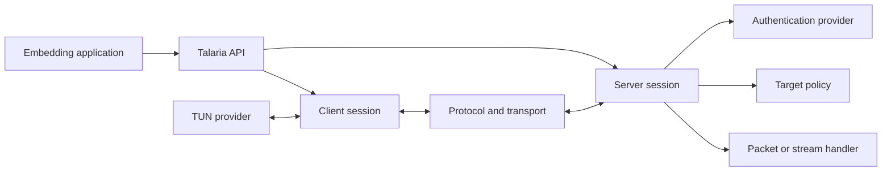

# Talaria

Talaria is an embeddable VPN library written in Go. It provides client and
server session management, authenticated tunnel transports, IP packet
processing, TUN integration, forwarding policy, and resource controls without
shipping an application or command-line program.

## Installation

```sh
go get github.com/X-VPN/Talaria
```

## Features

- Two protocol modes: `TalariaUDP` and `TalariaTCP`.
- TLS 1.3 handshakes implemented with Go's standard `crypto/tls` package.
- Directional AEAD records, sequence counters, and replay protection for the
  UDP data channel.
- Retry-bound authentication for TalariaUDP handshake datagrams.
- gVisor-based TCP flow handling for `TalariaTCP`.
- Session-bound data credentials and explicit session revocation.
- Configurable authentication, forwarding, destination policy, TUN, dialing,
  event, and statistics interfaces.
- Admission limits for unauthenticated handshakes, sessions, streams, queues,
  and outbound dials.
- Platform-neutral client TUN and server TUN-device interfaces.

## Architecture



Talaria owns the VPN data path and its security state. The embedding
application owns process lifecycle, routing installation, credentials,
certificate provisioning, account policy, telemetry, and user interface.

The primary client interface is:

```go
type Session interface {
    Start(ctx context.Context) error
    Close() error
    Done() <-chan struct{}
    State() State
    Err() error
    LocalAddr() string
}
```

A `Session` is single-use and does not reconnect itself. `Err` reports why it
terminated, and returns nil when the caller closed it deliberately, so the
embedding application can decide whether reconnecting is worthwhile:

```go
<-session.Done()
switch err := session.Err(); {
case err == nil:
    // Closed by us; nothing to do.
case errors.Is(err, client.ErrAuthRejected),
    errors.Is(err, client.ErrInvalidConfig),
    errors.Is(err, client.ErrUnsupportedProtocol):
    // Retrying with the same inputs cannot succeed.
    return err
default:
    // Transport-level failure; a new session may succeed.
    return retryWithBackoff(err)
}
```

Platform TUN implementations enter through:

```go
type TunProvider interface {
    Establish(ctx context.Context, cfg TunConfig) (Tun, error)
}
```

Server authentication and packet forwarding are explicit dependencies:

```go
type AuthProvider interface {
    Authenticate(ctx context.Context, req AuthRequest) (AuthResult, error)
}

type PacketHandler interface {
    HandlePacket(
        ctx context.Context,
        session SessionContext,
        packet *vpnpacket.VpnPacket,
    ) ([]*vpnpacket.VpnPacket, error)
}
```

The server will not start without both providers.

## Protocols

### TalariaUDP

1. Client and server complete a standard TLS 1.3 handshake.
2. TLS exporter material is expanded with HKDF into independent directional
   keys and nonce salts. This is epoch 0.
3. VPN headers and IP payloads are protected with the TLS cipher suite's AEAD.
4. A source- and packet-bound Retry exchange precedes server-side session
   allocation. Its listener-local MAC key exists only in process memory.
5. Retry-derived, direction-specific authentication protects subsequent
   handshake datagrams, including acknowledgements, before TLS completes.
6. A deployment-keyed AES-GCM envelope hides and authenticates every UDP
   datagram before Retry parsing, so a probe without the deployment secret gets
   no response and sees none of the internal framing markers.

The UDP data channel is a Talaria protocol built from TLS exporter material;
it is not DTLS.

The built-in TalariaUDP client and server must receive the same secret of at
least 32 bytes through `ClientOptions.TalariaUDPWireSecret` and
`ServerConfig.TalariaUDPWireSecret`, plus the same endpoint-unique identity
through `ClientOptions.TalariaUDPWireIdentity` and
`ServerConfig.TalariaUDPWireIdentity`. Only the authenticated wire profile is
available; peers never downgrade automatically.

#### Data record format and epochs

Each record is `type(1) ‖ epoch(4) ‖ sequence(4)` followed by the AEAD
ciphertext. The whole header is the additional data, so both the epoch and the
sequence a record claims are authenticated. The nonce is
`salt(4) ‖ epoch(4) ‖ sequence(4)`, exactly the 12 bytes the AEAD takes.

A single key cannot protect an unbounded number of records, so the sender
advances the epoch before reaching the AEAD confidentiality limit and restarts
the sequence. Long-lived tunnels therefore continue without reconnecting for
key exhaustion.

Each epoch's key is derived from the previous one:

```
key(0)   = HKDF-Expand(exporter material, "…/c2s-key" | "…/s2c-key")
key(n+1) = HKDF-Expand(key(n), "…/epoch")
```

The exporter root is discarded once epoch 0 exists and nothing retains a
long-lived secret, so an attacker holding a later epoch cannot recover an
earlier one. Deriving every epoch from a retained root would allow direct
lookup of any epoch, but would give that property up.

The receiver accepts exactly three epochs:

- the current epoch;
- the next epoch, derived with one ratchet, committed **only after the record
  authenticates** — otherwise anyone who knows the five-tuple could retire a key
  the peer is still using;
- the previous epoch, retained so records reordered across the boundary still
  open.

Anything further ahead is dropped without deriving a key, which is what stops a
spoofed epoch field from forcing HKDF work. Replay state is kept per epoch and
rotates with the key, because sequences restart each epoch.

### TalariaTCP

TalariaTCP carries a protected control connection and one protected SOCKS5
`CONNECT` stream per TCP flow. It wraps the full TLS 1.3 stream in a
deployment-keyed transform with a randomized, authenticated preamble. Non-TCP
IP packets remain on the authenticated control connection.

The built-in TalariaTCP client and server require matching secrets of at least
32 bytes through `ClientOptions.TalariaTCPWireSecret` and
`ServerConfig.TalariaTCPWireSecret`. Both peers must also set the same
`TalariaTCPWireIdentity`. The identity must be unique for each separately
addressed endpoint, especially when a wire secret is reused. The preamble is
checked before TLS, and peers never fall back to an untransformed TLS stream.

#### Wire compatibility policy

TalariaUDP and TalariaTCP each accept one wire profile and use stable,
unversioned domain-separation labels. There is no compatibility fallback or
downgrade path. Client and server deployments must use matching wire identifiers
and VPN command IDs. Any incompatible format change requires explicit protocol
negotiation and a coordinated rollout.

## Package Layout

| Package | Purpose |
|---|---|
| `github.com/X-VPN/Talaria` | High-level client and server entry points |
| `client` | Client state machine, authentication, keepalive, and TUN copy loops |
| `client/defaults` | Built-in TalariaUDP and TalariaTCP client transport composition |
| `client/dataplane` | Packet buffers, MTU calculation, and packet codec |
| `client/platform` | Platform-neutral TUN interfaces |
| `client/flowrelay` | TalariaTCP gVisor flow conversion and stream relay |
| `server` | Listeners, authentication, sessions, policy, forwarding, and TUN handling |
| `protocol/udptls` | TLS handshake, key derivation, AEAD records, and replay handling |
| `protocol/vpnpacket` | VPN packet encoding and validation |
| `transport` | Transport interfaces, session grants, registry, and relay |
| `transport/socks5tls` | TalariaTCP TLS carrier, SOCKS5 streams, and admission control |

Everything under `internal/` is implementation detail and deliberately not part
of the public API: UDP session and queue management, IP packet parsing and
rewriting, control-record framing, and dial timeouts. They appear in no exported
signature, so they can change without a breaking release.

## Client Integration

The high-level constructor selects the built-in transport for the configured
protocol. The caller supplies a TUN provider and verified TLS configuration.

```go
roots := x509.NewCertPool()
if !roots.AppendCertsFromPEM(caPEM) {
    return errors.New("invalid CA certificate")
}

session, err := talaria.NewClient(
    talaria.Config{
        Protocol:   talaria.ProtocolTalariaTCP,
        ClientID:   clientID,
        SecretKey:  secretKey,
        EntranceIP: "10.0.0.2",
        ExitIP:     "10.0.0.1",
        ServerIP:   serverIP,
        Domain:     serverName,
        ServerPort: 443,
    },
    tunProvider,
    talaria.ClientOptions{
        TLSConfig: &tls.Config{
            ServerName: serverName,
            RootCAs:    roots,
        },
        TalariaTCPWireSecret:   wireSecret,
        TalariaTCPWireIdentity: serverName,
    },
)
if err != nil {
    return err
}

if err := session.Start(ctx); err != nil {
    return err
}
defer session.Close()
```

Applications that provide a different transport can call `client.NewSession`
with their own `client.Deps`. This keeps platform and deployment behavior
outside the core session state machine.

## Server Integration

The built-in transports require explicit, static certificate configuration.
The server accepts `server.StaticAuthProvider`, `server.ReferenceTargetPolicy`,
and the built-in echo or TUN packet handlers. Dynamic TLS callbacks and
caches, TLS client-authentication configuration, and custom auth, outbound, or
packet-handler callbacks fail before listener allocation. No credentials,
private keys, or packet handler are selected by default. Production TalariaUDP
packet forwarding requires
`server.TunPacketHandler`.

```go
targetPolicy, err := server.NewReferenceTargetPolicy(server.ReferenceTargetPolicyConfig{
    ProtectedPrefixes: managementPrefixes,
    NAT64Prefixes:     deploymentNAT64Prefixes,
})
if err != nil {
    return err
}

packetHandler, err := server.NewTunPacketHandler(server.TunPacketHandlerConfig{
    Device:          serverTunDevice,
    VirtualIPBase:   netip.MustParseAddr("172.21.100.2"),
    VirtualIPPrefix: netip.MustParsePrefix("172.21.100.0/24"),
    TargetPolicy:    targetPolicy,
})
if err != nil {
    return err
}

vpnServer, err := talaria.StartServer(ctx, talaria.ServerConfig{
    Protocol:               talaria.ProtocolTalariaUDP,
    Host:                   "0.0.0.0",
    Port:                   443,
    CertPEM:                string(certPEM),
    KeyPEM:                 string(keyPEM),
    TalariaUDPWireSecret:   wireSecret,
    TalariaUDPWireIdentity: serverName,
    Auth:                   server.StaticAuthProvider{Credentials: credentials},
    PacketHandler:          packetHandler,
    TargetPolicy:           targetPolicy,
})
if err != nil {
    return err
}
defer vpnServer.Close()
```

### Destination policy defaults

The default `server.ReferenceTargetPolicy` denies loopback, link-local,
multicast, unspecified, broadcast, well-known cloud metadata addresses, the
server's own interface addresses, and RFC 1918, RFC 6598 and IPv6 ULA
destinations. An authenticated client therefore cannot reach the server's own
LAN or VPC unless the deployment opts in:

```go
policy, err := server.NewReferenceTargetPolicy(server.ReferenceTargetPolicyConfig{
    AllowPrivateTargets: true,
    ProtectedPrefixes:   managementPrefixes,
    NAT64Prefixes:       deploymentNAT64Prefixes,
})
if err != nil {
    return err
}
```

`ProtectedPrefixes` remains the way to block deployment-specific control planes
regardless of that setting. `NAT64Prefixes` must list every network-specific
Pref64 routed by the deployment; a nil list rejects IPv6 targets, while a
non-nil empty list declares that no network-specific Pref64 is enabled. The
well-known `64:ff9b::/96` prefix is always decoded.

## Session Lifecycle

- A client TUN is established only after transport and application
  authentication succeed and the server sends an explicit session-ready
  confirmation.
- TalariaTCP data streams must present the credential for the current client and
  generation.
- Replacing, revoking, idling out, or closing a control session invalidates its
  data streams.
- A client `Session` does not reconnect itself. The embedding application may
  create a new session according to its own retry and network-change policy.

## Security Properties

- TLS certificate verification cannot be disabled by the built-in client
  transports.
- TLS versions are restricted to TLS 1.3.
- Protocol names are parsed exactly and unknown modes are rejected.
- Authentication is completed before TUN creation or packet forwarding.
- Untrusted packet parsers enforce length and format limits.
- Session and transport resource limits have finite defaults.
- Connection establishment, authentication, normal server writes, and
  outbound dialing have bounded timeouts.
- TalariaUDP enforces per-key AEAD record limits and closes before counter
  exhaustion.
- TalariaUDP outer framing is authenticated and encrypted with a deployment
  secret; packets that cannot open are dropped before Retry responds.
- UDP retry-cookie keys are generated when a listener is created, remain only
  in process memory, and are cleared when the listener closes.
- Session credentials are generated with `crypto/rand`, stored as hashes by
  the registry, compared in constant time, and excluded from logs.

The caller remains responsible for secure credential validation, certificate
and private-key storage, route and DNS policy, process isolation, firewalling,
and operating-system hardening.

## Platform Notes

- Talaria does not create or configure operating-system TUN devices.
- Client applications provide a `client.TunProvider`; server applications can
  inject a `server.TunDevice` into `server.NewTunPacketHandler`.
- A TUN virtual IP remains bound to one authenticated client ID for the
  handler's lifetime, so size `VirtualIPPrefix` for the number of distinct IDs.
- `server.TunDevice.ReleaseVirtualIP` must flush queued traffic and network
  state before an address is reused by the same authenticated client.
- Platform integrations own interface creation, addresses, MTU, routes, DNS,
  NAT, privileges, and cleanup.
- iOS supports `TalariaUDP`; the embedding application supplies its
  Network Extension TUN adapter.

## Testing

Run the complete unit, integration, and parser test suite with:

```sh
GOWORK=off go test ./...
```

Run race detection on supported hosts with:

```sh
GOWORK=off go test -race ./...
```

The repository includes fuzz targets for VPN packet parsing, IP packet parsing,
control framing, SOCKS5/TLS input, and pre-authentication server handling.

## License

Talaria is licensed under the GNU Affero General Public License version 3 only
(`AGPL-3.0-only`). See [`LICENSE`](LICENSE) for the complete terms.

The AGPL includes source-code obligations for covered modified versions made
available for users to interact with over a network. This summary does not
replace the license terms.

Third-party components remain subject to their respective licenses. See
[`THIRD_PARTY_NOTICES.md`](THIRD_PARTY_NOTICES.md) for the dependency and
attribution inventory.

Copyright (C) 2026 LIGHTNINGLINK NETWORKS PTE. LTD.
